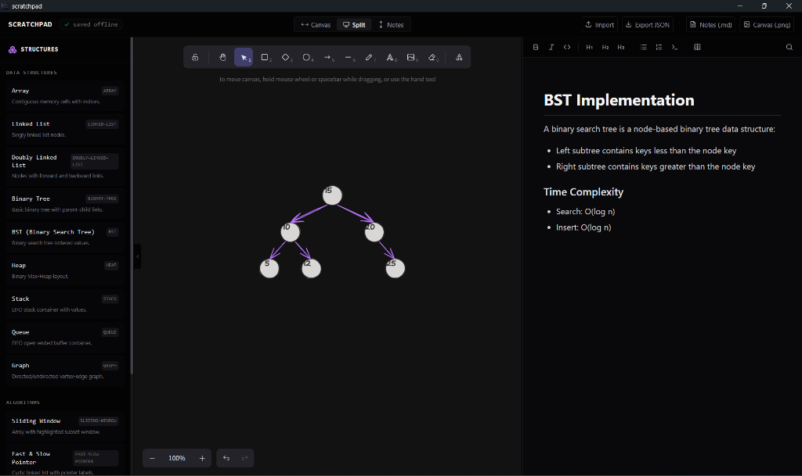
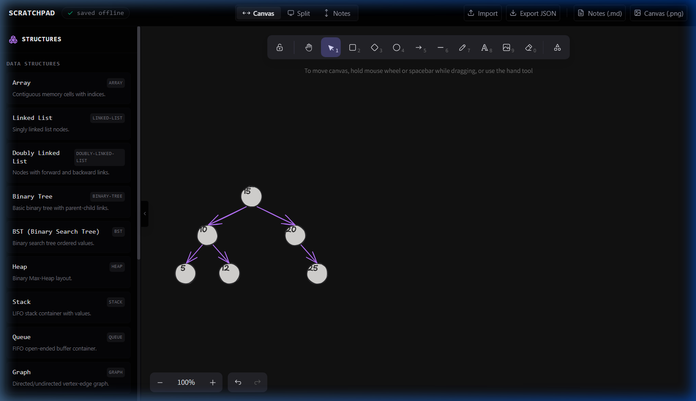
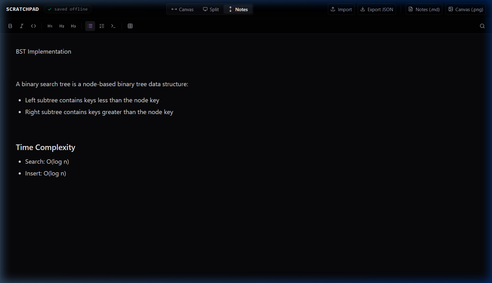

# Scratchpad

Scratchpad combines notes and an infinite canvas in a single workspace.

It is a local-first desktop application designed for developers, students, and problem solvers to organize diagrams, code notes, and algorithmic templates side-by-side. By integrating a spatial canvas with a rich markdown editor, Scratchpad provides a distraction-free environment for visual thinking.

## Screenshots







## Core Features

- **Infinite Canvas**: Draw diagrams, construct custom flowcharts, and sketch designs on an unconstrained canvas powered by Excalidraw.
- **Markdown Notes**: Write structured documentation, tables, and code snippets in a rich markdown pane powered by TipTap.
- **Workspace Tabs**: Keep multiple scratchpads open in one window. Each tab holds its own notes and canvas, with double-click rename and one-click close.
- **Search Palette**: One command-palette UI for finding text across your notes and canvas, then jumping straight to a match — switching tabs, revealing the right pane, and selecting the matched note text or canvas element automatically. `Ctrl/Cmd+F` scopes it to the current tab; `Ctrl/Cmd+Shift+F` (or the tab-bar search icon) searches every open tab.
- **Local-First Architecture**: Your workspace data is saved entirely on your local machine using client-side storage.
- **Offline Support**: Fully functional without internet connectivity, ensuring you can work from anywhere.
- **Import / Export**: Save work as portable JSON files, export notes to Markdown, or save canvas sketches as images.
- **Structure Templates**: Quickly drag, drop, and edit pre-built templates for common data structures and algorithm patterns.
- **Fast Performance**: Optimized rendering ensures typing, drawing, and UI resizing remain responsive.
- **Dark Mode**: A unified dark interface designed to reduce eye strain during long-duration sessions.

## Use Cases

- **DSA Practice**: Visualize tree traversals, stack behaviors, or queue operations alongside implementation notes.
- **LeetCode Problem Solving**: Map out problem logic and edge cases visually before writing code.
- **Interview Preparation**: Practice system design or coding interviews in a mock whiteboard environment.
- **System Design**: Draft network diagrams, database schemas, and application architecture.
- **Brainstorming**: Sketch ideas, wireframes, and concept maps dynamically.
- **Learning and Note Taking**: Maintain structured programming notes alongside conceptual drawings.

## Keyboard Shortcuts

| Command | Action |
|:---|:---|
| `Ctrl + K` / `Cmd + K` | Open the DSA structure command palette |
| `Ctrl + F` / `Cmd + F` | Open the search palette scoped to the current tab |
| `Ctrl + Shift + F` / `Cmd + Shift + F` | Open the search palette across all tabs |
| `Ctrl + T` / `Cmd + T` | Open a new tab |
| `Ctrl + B` / `Cmd + B` | Cycle layout modes (Split, Canvas Only, Notes Only) |
| `Ctrl + S` / `Cmd + S` | Force manual workspace save |
| `T` | Select Text tool (Canvas focused) |
| `D` | Select Freedraw tool (Canvas focused) |
| `E` | Select Eraser tool (Canvas focused) |
| `A` | Select Arrow tool (Canvas focused) |
| `L` | Select Line tool (Canvas focused) |
| `R` | Select Rectangle tool (Canvas focused) |

## Tech Stack

- **React**: Frontend UI framework.
- **TypeScript**: Static typing for robust application state.
- **Electron**: Desktop container for cross-platform execution.
- **Excalidraw**: High-performance canvas drawing engine.
- **TipTap**: Extensible rich-text editor toolkit.
- **Tailwind CSS**: Utility-first styling framework.

## Philosophy

- **Local-first**: You own your data. Files are kept on your hard drive, not on third-party servers.
- **No account required**: No sign-up flow, email forms, or onboarding prompts. The workspace is available instantly.
- **No cloud dependency**: Does not require cloud connectivity, telemetry, or remote assets to function.
- **No distractions**: A minimalist, utility-focused layout designed to keep you in flow.
- **Fast and lightweight**: Debounced auto-saves and targeted React updates to ensure smooth operation on standard developer hardware.

## Download

Pre-built Windows installers are available under [GitHub Releases](https://github.com/VarunArora24/Scratchpad/releases). Download the executable to run the desktop application natively.

## Installation & Development

To clone, set up, and run the development environment locally:

```bash
# Clone the repository
git clone https://github.com/VarunArora24/Scratchpad.git
cd Scratchpad

# Install project dependencies
npm install

# Start the local development server
npm run dev
```

## Build Instructions

To build and package the application for desktop distribution:

```bash
# Compile and package binaries
npm run build
```

This compiles the frontend assets and packages the Electron application into the `release/` directory using `electron-builder`.

## Project Directory Structure

```
Scratchpad/
├── src/
│   ├── assets/           # Media assets and desktop icons
│   ├── components/       # Core UI and layout components
│   │   ├── Canvas.tsx          # Excalidraw drawing wrapper
│   │   ├── Editor.tsx          # TipTap rich-text editor
│   │   ├── Toolbar.tsx         # Workspace controls and actions
│   │   ├── TabBar.tsx          # Workspace tab strip (switch/add/rename/close)
│   │   ├── StructuresPanel.tsx # DSA template sidebar
│   │   ├── CommandPalette.tsx  # DSA structure insertion palette
│   │   ├── SearchPalette.tsx   # Cross-tab notes search palette
│   │   └── NotificationToast.tsx # Custom system feedback notifications
│   ├── config/           # Static configurations and structures
│   ├── db/               # IndexedDB database wrappers
│   ├── store/            # Zustand global workspace store
│   ├── index.css         # Styling and custom theme configuration
│   ├── main.tsx          # Application entry point
│   └── App.tsx           # Layout workspace resizer
├── index.html            # Main HTML document
├── package.json          # Dependency and build scripts
└── vite.config.ts        # Vite building configurations
```

## Roadmap

- **Better Structure Templates**: Expand templates for recursion trees, matrix systems, and custom graphs.
- **Command Palette**: Add direct shortcuts, theme switching, and quick navigation capabilities.
- **Improved Export Options**: Add direct PDF and JSON schema export features, including multi-tab workspace export.

## Repository Improvements

### Ignored Compiler Output and Packaged Binaries
- **Current issue**: The workspace generates typescript build cache files (`.tsbuildinfo`) and local configuration files, which can accidentally get committed if they are not explicitly listed in `.gitignore`.
- **Why it matters**: Accidental commits of build cache files or developer environment files pollute the history, bloat the repository size, and cause unnecessary merge conflicts.
- **Recommended fix**: Extend the `.gitignore` configuration to explicitly exclude all TypeScript caches, environment configurations, and build/compilation artifacts.

### Clarity of Build Assets vs. Outputs
- **Current issue**: The `build/` folder contains only static branding resources (like `icon.png`) for desktop packaging, which can easily be mistaken for a generated build output folder (similar to a standard Create React App or Webpack build folder).
- **Why it matters**: Developers might inadvertently add `build/` to `.gitignore` or clean scripts, deleting the desktop application icon and causing subsequent application packaging runs to fail.
- **Recommended fix**: Document the purpose of the `build/` folder, configure packaging commands to output strictly to `dist/` (web assets) and `release/` (packaged desktop installers), and keep the `build/` folder committed solely for branding assets.

## Release Management

A professional GitHub release workflow is recommended to separate source code from compiled execution packages:

- **Source Code**: Track only the source configuration files, code directories (`src/`), branding assets, and project files in the main Git repository branches.
- **Compiled Installers**: Avoid committing compiled execution packages (e.g., `.exe` installers, `.zip` folders) to Git. These installers should be generated on clean build runners and distributed exclusively through GitHub Releases.

### Handling the `build/` Directory
The `build/` directory contains `icon.png` which is the desktop application icon referenced by the Electron packager. 
- **Recommendation**: The `build/` directory **must remain committed** to the repository because `build/icon.png` is a source design asset, not a generated build artifact.
- **Git Integration**: To ensure `build/icon.png` is tracked while avoiding the accidental tracking of any other system-generated files in that directory, use the following configuration in `.gitignore`:

```gitignore
# Exclude build output folders
dist/
dist-ssr/
release/

# Only track packaging branding assets inside the build directory
build/*
!build/icon.png
```

