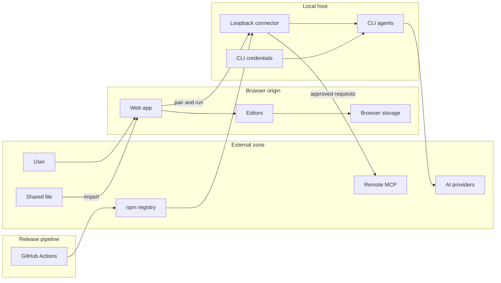

# ScratchPad focused threat model

## Executive summary

The highest-risk boundary is the production browser origin to the local connector: the current browser automatically receives broad session scopes, so compromise of first-party or remotely loaded JavaScript can become authenticated local-agent and MCP access. Shared workspace, Markdown, and PDF files are the second major boundary; they are currently read and parsed without resource budgets or a strict workspace schema, and PDF sources are rendered in an unsandboxed iframe. The exact published connector 0.2.5 otherwise has a strong defensive core—loopback Host checks, origin-bound sessions, input/output limits, SSRF protection, fixed tool-restricted agents, safe resolver rules, credential isolation, a zero-advisory dependency graph, and a tightly gated release workflow.

## Scope and assumptions

In scope:

- Exact published @algoglyph/mcp-connector@0.2.5 and matching checked-in sources under packages/mcp-connector.
- Browser connector client and automatic pairing under src/lib/mcp and src/store/mcpStore.ts.
- Web shared-file import and rendering paths in Toolbar, Editor, PdfEmbed, notePdfStore, workspaceStore, indexedDB, and Canvas.
- The connector package release and dependency controls in packages/mcp-connector/test/package-release.mjs and .github/workflows/publish-mcp.yml.

Out of scope:

- Electron runtime, IPC, preload, packaging, and desktop navigation.
- Diagram-generation correctness, Canvas layout quality, MCP protocol redesign beyond security recommendations, Firebase, and Wandbox correctness.
- Live exploitation of real AI provider accounts.
- Untracked .wrangler content.

Assumptions:

- Shared/imported workspace, Markdown, and PDF files may be attacker-authored.
- The production web app is internet-accessible and any visitor can open /workspace.
- The connector is intentionally local, binds only to loopback, and runs with the logged-in user’s privileges.
- Codex, Antigravity, and Claude are trusted installed programs; an attacker cannot already replace those installations or write arbitrary files into the user’s trusted bin directories.
- AI prompts, generated output, local workspace data, connector session tokens, provider credentials, and remote MCP bearer tokens are sensitive.
- Automatic browser pairing is intended product behavior, but silent privileged execution is not assumed to be an acceptable consequence of a compromised production origin.

Open questions that would materially change ranking:

- Are remote PDF URLs a required feature, or may imported PDF nodes be restricted to locally validated pdfstore references?
- Can all remote analytics/tag scripts be removed from /workspace?
- Is a terminal/local confirmation step acceptable before the first agent:run or MCP operation?

Artifact grounding:

- The downloaded npm tarball SHA-256 was 837584fa9bc8d295f030b2094d056a0085200b1a3010732d4b9a5f99ce909aa1.
- Its runtime and resolver were byte-for-byte identical to packages/mcp-connector/bin/algoglyph-mcp-connector.mjs and packages/mcp-connector/bin/cli-runtime.mjs.
- Its isolated production dependency audit reported zero known vulnerabilities.

## System model

### Primary components

- Web application: React/Vite application that owns routing, notes, canvas, file import, local persistence, and connector bootstrap. Evidence: src/App.tsx:70-127, src/components/Toolbar.tsx:99-161, and src/components/Editor.tsx:115-220.
- Browser storage: workspace state and PDF bytes persist in IndexedDB; connector bearer tokens persist per tab in sessionStorage. Evidence: src/db/indexedDB.ts:111-148, src/lib/notePdfStore.ts:25-89, and src/store/mcpStore.ts:44-66.
- Loopback connector: Node HTTP server on 127.0.0.1 with health, pairing, session, catalog, MCP, and agent-run routes. Evidence: packages/mcp-connector/bin/algoglyph-mcp-connector.mjs:3594-3742.
- CLI resolver and adapters: discovers Codex, Antigravity, and Claude without a discovery shell, then starts fixed tool-restricted adapters. Evidence: packages/mcp-connector/bin/cli-runtime.mjs:97-385 and packages/mcp-connector/bin/algoglyph-mcp-connector.mjs:71-138.
- Remote MCP client/relay: validates operator/browser-supplied MCP endpoints, blocks SSRF, inspects tools, and exposes only approved tools to an agent through a tokenized loopback relay. Evidence: packages/mcp-connector/bin/algoglyph-mcp-connector.mjs:1035-1247 and packages/mcp-connector/bin/algoglyph-mcp-connector.mjs:1438-1755.
- External providers: trusted CLIs use the user’s existing authentication to call their respective AI providers. Evidence: packages/mcp-connector/bin/algoglyph-mcp-connector.mjs:871-980.
- Release pipeline: GitHub Actions verifies the lock, tests, native package smoke, lint, and build before a separate minimal-OIDC publish job. Evidence: .github/workflows/publish-mcp.yml:18-92.

### Data flows and trust boundaries

- Attacker-authored file → Web application: workspace JSON/Markdown or note Markdown/PDF bytes cross through File/FileReader APIs. There is user selection/drop, but no authentication, signature, strict schema, or size/depth/count budget. Evidence: src/components/Toolbar.tsx:99-161 and src/components/Editor.tsx:184-220.
- Web application → TipTap/Excalidraw: parsed Markdown, PDF node attributes, canvas elements, app state, and binary files cross in-memory component boundaries. The custom PDF node directly uses its src, and Excalidraw receives imported scene objects without an application schema. Evidence: src/components/notes/PdfEmbed.tsx:35-43, src/components/notes/PdfEmbed.tsx:82-145, and src/components/Canvas.tsx:225-239.
- Web application → IndexedDB/sessionStorage: notes, canvases, files, PDFs, and connector bearer tokens cross into origin-scoped browser storage. IndexedDB uses structured clone, but the application clone is recursively unbounded; the connector token is available to same-origin JavaScript. Evidence: src/db/indexedDB.ts:85-148, src/lib/notePdfStore.ts:50-89, and src/store/mcpStore.ts:44-66.
- Production origin → Loopback connector: pairing tokens, session tokens, prompts, remote MCP endpoints/tokens, and tool arguments cross HTTP to 127.0.0.1. Controls include exact Origin allowlisting, loopback Host validation, CORS/PNA, bearer scopes, expiry, rate limits, bounded JSON, and owner-bound grants. Automatic pairing defaults to every scope and has no local user-presence proof. Evidence: packages/mcp-connector/bin/algoglyph-mcp-connector.mjs:275-301, packages/mcp-connector/bin/algoglyph-mcp-connector.mjs:550-632, and packages/mcp-connector/bin/algoglyph-mcp-connector.mjs:3623-3698.
- Loopback connector → Installed CLI: fixed arguments, prompts, selected relay configuration, isolated working directories, and limited authentication material cross a child-process boundary with shell:false. Codex/Agy receive isolated homes; Claude retains its real profile but has dangerous environment variables removed and safe mode enabled. Evidence: packages/mcp-connector/bin/algoglyph-mcp-connector.mjs:71-138, packages/mcp-connector/bin/algoglyph-mcp-connector.mjs:871-980, and packages/mcp-connector/bin/algoglyph-mcp-connector.mjs:3271-3591.
- Loopback connector → Remote MCP: endpoint URL, optional bearer token, MCP protocol requests, catalogs, and tool results cross HTTPS, or explicitly approved loopback HTTP. Controls include scheme/credential validation, reserved-address blocking, abort-bounded DNS, per-request DNS pinning, redirect revalidation, origin-bound bearer forwarding, size/time/page limits, and owner expiry. Evidence: packages/mcp-connector/bin/algoglyph-mcp-connector.mjs:1035-1538.
- Installed CLI → AI provider: prompts and generated responses cross each provider’s native authenticated network channel. The connector relies on the trusted CLI/provider for TLS and provider authentication, while bounding local run time and returned bytes. Evidence: packages/mcp-connector/bin/algoglyph-mcp-connector.mjs:28-39 and packages/mcp-connector/bin/algoglyph-mcp-connector.mjs:3400-3579.
- GitHub repository → npm registry → User connector: source, lock, tarball, native node-pty build, and OIDC provenance cross build and package-management boundaries. Actions are commit-SHA pinned, package dependencies are exact, tarball files are allowlisted, signatures/advisories are checked, and only the publish job has id-token:write. Evidence: packages/mcp-connector/test/package-release.mjs:24-45, packages/mcp-connector/test/package-release.mjs:227-280, and .github/workflows/publish-mcp.yml:18-92.

#### Diagram

## Assets and security objectives

| Asset | Why it matters | Security objective (C/I/A) |
|---|---|---|
| Workspace notes, canvases, code, tabs, and visualizer state | User-created local work may be private and difficult to reconstruct | C, I, A |
| Stored PDF bytes | May contain private course, work, or personal documents | C, I, A |
| Connector session and pairing tokens | Authorize catalog, agent, and MCP operations against a local privileged process | C, I |
| Provider credentials and OAuth state | Permit billable/authenticated use of Codex, Antigravity, and Claude | C, I |
| Prompts and model output | May include private workspace content and are sent to external providers | C, I |
| Remote MCP bearer tokens and grants | Authorize third-party tool access and may expose sensitive MCP data/actions | C, I |
| Installed CLI resolver decisions | Determine which local executable receives credentials and prompts | I |
| Connector and browser availability | Required for AI features and local workspace usability | A |
| Published npm artifact and provenance | Compromise affects every user who installs or executes the connector | I, A |

## Attacker model

### Capabilities

- Can publish or send a malicious workspace, Markdown, or PDF-like file and persuade a user to import/drop it.
- Can operate an arbitrary internet HTTPS origin and a malicious MCP server.
- Can exploit a future or existing production-origin XSS, compromised deployment, or third-party script supply-chain event.
- Can return malformed, oversized, slow, redirecting, or adversarial MCP protocol data.
- Can attempt browser-to-loopback requests from an untrusted web origin.
- Can submit inputs at the documented HTTP and file-import entry points once legitimately paired or after compromising the trusted origin.

### Non-capabilities

- Cannot directly read another origin’s IndexedDB/sessionStorage or bypass browser same-origin policy without an XSS or active same-origin document.
- Cannot already write arbitrary executables into trusted global/user bin directories, replace the installed CLIs, alter the npm artifact after integrity verification, or control the logged-in OS account.
- Cannot directly reach a non-loopback connector listener; the connector binds to 127.0.0.1.
- Cannot use arbitrary shell commands merely by controlling prompts; connector commands and flags are fixed, Codex/Claude built-ins are denied, and MCP relays are allowlisted.

## Entry points and attack surfaces

| Surface | How reached | Trust boundary | Notes | Evidence (repo path / symbol) |
|---|---|---|---|---|
| Workspace import | User selects .md or .json | Shared file → browser | Whole-file read, JSON parse, shallow validity check | src/components/Toolbar.tsx:99-161 |
| Note file import/drop | User selects or drops Markdown/PDF files | Shared file → TipTap/PDF store | Multiple whole files, extension-or-MIME PDF recognition, no budgets | src/components/Editor.tsx:49-54 and src/components/Editor.tsx:184-220 |
| PDF node | Imported Markdown or local PDF insertion | Note state → iframe/navigation | Arbitrary direct src, unsandboxed iframe, supplied Blob MIME | src/components/notes/PdfEmbed.tsx:35-43 and src/components/notes/PdfEmbed.tsx:82-145 |
| Canvas scene load | Workspace import/tab load | Imported object graph → Excalidraw | Application does not enforce canonical element/file schema | src/components/Canvas.tsx:225-239 |
| Browser automatic pairing | Workspace bootstrap | Internet origin → loopback | Trusted origins only, but default pairing grants all scopes | src/lib/mcp/bootstrap.ts:70-108 and packages/mcp-connector/bin/algoglyph-mcp-connector.mjs:275-301 |
| Connector HTTP routes | Fetch to loopback | Browser/native client → local process | Host, Origin, bearer scope, rate, size, and method checks | packages/mcp-connector/bin/algoglyph-mcp-connector.mjs:3594-3706 |
| CLI discovery/version probe | Catalog request | Local filesystem/PATH → child process | Trusted roots, no discovery shell, project shadows rejected, safe version probe | packages/mcp-connector/bin/cli-runtime.mjs:97-385 and packages/mcp-connector/bin/algoglyph-mcp-connector.mjs:748-867 |
| Agent run | Authorized POST | Browser prompt → authenticated CLI/provider | Fixed agents, one active run, time/output limits, owner-bound worker | packages/mcp-connector/bin/algoglyph-mcp-connector.mjs:3271-3591 |
| MCP approval/invoke | Authorized POST | Browser → connector → remote server | SSRF and size controls; direct invoke UI confirms, but browser boolean is not user presence | packages/mcp-connector/bin/algoglyph-mcp-connector.mjs:1382-1550 and src/components/McpConnectDialog.tsx:204-230 |
| npm publish | Manual workflow on main | GitHub → npm registry | Commit-pinned actions, verify gate, OIDC only in publish job | .github/workflows/publish-mcp.yml:18-92 |

## Top abuse paths

1. Production-origin agent abuse: compromise remote tag or first-party JavaScript → call automatic pairing → receive all default scopes → submit billable agent prompts or exercise MCP capabilities → consume quota and expose outputs.
2. Conditional same-origin PDF execution: provide a PDF-named File with active MIME/non-PDF bytes → app accepts by extension and preserves MIME → app creates a same-origin Blob iframe without sandbox → active content targets browser storage and the connector session.
3. Remote PDF tracking/spoofing: embed an attacker HTTPS src in shared Markdown → TipTap creates a PDF node → workspace automatically frames attacker content → attacker observes the request and presents convincing content inside the app.
4. Workspace denial of service: send a large or deeply nested workspace → FileReader and JSON.parse allocate it → unbounded recursive clone and Excalidraw/TipTap processing block or overflow → workspace becomes unavailable or fails persistently.
5. Dependency-assisted parser attack: place adversarial canvas/diagram-shaped data in an imported workspace → pass it to Excalidraw’s browser-facing dependency graph → reach a vulnerable Mermaid/DOMPurify/Nano ID path if the feature is exposed → CSS injection, state corruption, or DoS. Reachability is not yet proven.
6. Malicious remote MCP: persuade a user to test an attacker server → return adversarial catalogs/results or redirects → attempt SSRF, token forwarding, or resource exhaustion. Current DNS pinning, redirect revalidation, token origin checks, and limits substantially constrain this path.
7. Resolver path planting: gain write access to a trusted per-user bin root → place a malicious executable named codex, agy, or claude → wait for a catalog version probe or run. This requires same-user filesystem capability; project-local and shell-wrapper attacks are rejected.

## Threat model table

| Threat ID | Threat source | Prerequisites | Threat action | Impact | Impacted assets | Existing controls (evidence) | Gaps | Recommended mitigations | Detection ideas | Likelihood | Impact severity | Priority |
|---|---|---|---|---|---|---|---|---|---|---|---|---|
| TM-001 | Compromised production-origin script | XSS, deployment compromise, or remote tag compromise under an allowed origin | Automatically pair for all scopes and call agent/MCP routes | Quota use, prompt/output exposure, unauthorized tool activity, local connector DoS | Session tokens, provider accounts, prompts/output, MCP grants | Exact Origin and Host checks, scoped/expiring sessions, rate/output limits, fixed agents at packages/mcp-connector/bin/algoglyph-mcp-connector.mjs:550-632 and :3271-3591 | Origin is treated as sufficient user authorization; default all scopes; GTM on workspace; no CSP | Catalog-only automatic session; local user-presence step-up; action-bound one-use capabilities; first-party-only workspace; strict CSP | Log pairing, privilege grants, runs, endpoint origins, denials, and rate-limit spikes without content/secrets | Medium | High | high |
| TM-002 | Malicious shared PDF/Markdown author | Victim imports or drops crafted content | Cause remote iframe tracking/spoofing or conditionally create active same-origin Blob content | Browser storage/session theft in the conditional active-MIME case; tracking and UI spoofing otherwise | Workspace data, PDF data, connector token | User action and browser SOP for normal cross-origin frames | Extension OR MIME acceptance, preserved MIME, arbitrary src, no sandbox/referrer policy | Magic validation, force application/pdf, scheme allowlist, pdfstore-only import, sandbox, no-referrer, size limits | Client-side rejected-file metrics by reason; CSP violation reporting; remote-frame load telemetry without full URLs | Medium | High | high |
| TM-003 | Malicious shared workspace/notes author | Victim imports file | Exhaust memory/CPU/storage with bytes, depth, key counts, arrays, strings, canvas files, or many PDFs | Tab crash, storage exhaustion, persistent reload failure, possible local data loss | Workspace integrity and availability, IndexedDB quota | Catch blocks and quota notification; IndexedDB clone removes non-cloneable values at src/db/indexedDB.ts:85-137 | No pre-read size limits, strict schema, structural budgets, worker parsing, or transactional rollback | Versioned schema; global budgets; worker parsing; canonical copy; preflight storage estimate; rollback/recovery | Count import failures, parse time, object counts, quota errors, and recovery events locally | High | Medium | high |
| TM-004 | Malicious imported scene plus advisory-affected dependency | A vulnerable Excalidraw/Mermaid path must be reachable from imported data | Trigger CSS injection, prototype pollution, or parser loop | UI integrity loss or browser DoS; broader compromise depends on reachability | Workspace UI, browser availability | Excalidraw includes sanitize-url in its locked dependencies at package-lock.json:1734-1738 | Locked browser-facing advisories and no adversarial reachability tests | Controlled upgrades/overrides; isolate parser in worker; canonical scene validation; add malicious fixtures | Dependency alerts, CSP reports, long-task/crash telemetry, regression corpus | Low to Medium | Medium | medium |
| TM-005 | Malicious remote MCP server | User or compromised origin approves endpoint | Attempt SSRF, redirect to private network, steal token, return oversized/pathological protocol data, or misuse tools | Network pivot, token exposure, connector resource exhaustion, unsafe tool action | MCP token, local network, connector availability, tool data | HTTPS or explicit loopback, private-IP blocking, DNS pinning, redirect revalidation, token same-origin forwarding, page/byte/time limits, owner expiry at packages/mcp-connector/bin/algoglyph-mcp-connector.mjs:1035-1538 | Browser confirmation is client-provided; approved agent tools may act without a separate per-call local gesture | Server fingerprint pinning; signed action grants; explicit tool-risk labels; per-server budgets; deny dangerous schemas/tools by policy | Record destination origin, resolved IP class, redirects, tool names, result size, timeouts, and denials | Low | High | medium |
| TM-006 | Same-user local attacker | Can write a trusted PATH/per-user bin root but not the repo alone | Plant a named CLI executable and wait for version probe/run | Execute under connector user and receive prompts/auth environment appropriate to that agent | Provider credentials, prompts, local account | Realpath, executable checks, Node shebang allowlist, trusted Node, project/node_modules rejection, safe --version probe at packages/mcp-connector/bin/cli-runtime.mjs:140-385 | No owner/permission check on executable and parent directories; validation/spawn TOCTOU | Optionally reject group/world-writable executable roots; record inode/stat and revalidate before spawn; document same-user threat boundary | Log resolved real path/kind and changes without exposing usernames; alert on runtime identity changes | Low | High | low |
| TM-007 | Compromised/malicious installed CLI or provider plugin | Trusted CLI installation itself is compromised | Read its own supplied credentials/profile or ignore behavioral instructions | Credential theft, provider abuse, prompt leakage | Provider credentials, prompts/output | Isolated homes where supported, 0600 copies, env scrubbing, Claude safe mode, no shell, exact MCP relay at packages/mcp-connector/bin/algoglyph-mcp-connector.mjs:871-980 and :1650-1755 | Some CLIs must retain their real profile; connector cannot sandbox a malicious binary completely | Publish supported CLI/version policy; signature/notarization checks where feasible; process sandbox profiles; revalidate safe-mode behavior per release | Record CLI version/path identity and unexpected exits/tool attempts; never log secrets | Low | High | medium |
| TM-009 | Package supply-chain attacker | Must compromise repository, workflow authority, npm trusted publishing, registry, or a dependency/install script | Publish altered connector or compromise native build | Widespread local code execution on install/run | npm artifact, all connector users, credentials | Pinned Actions, exact deps, integrity lock, allowlisted tarball, signature/advisory audit, only node-pty install script, minimal OIDC at packages/mcp-connector/test/package-release.mjs:24-45 and .github/workflows/publish-mcp.yml:18-92 | Native node-pty install remains a high-value supply-chain surface; manual dispatch governance not visible in repo | Require protected environments/reviewers; provenance verification docs; reproducible artifact hashes; monitor node-pty changes; incident rollback plan | npm provenance/signature monitoring, unexpected package/hash alerts, publish audit trail | Low | Critical | medium |

## Criticality calibration

- Critical: enables broad, repeatable compromise of many users or arbitrary code execution without meaningful user interaction and without the current fixed-agent controls. Examples: a malicious published connector stealing CLI credentials from every install; an unauthenticated internet origin gaining unrestricted local shell access; a shared file yielding reliable same-origin code execution and silent arbitrary local command execution.
- High: crosses a major trust boundary with high-impact account/data/action consequences, but requires production-origin compromise, user import, or another significant prerequisite. Examples: compromised trusted-origin JavaScript silently running authenticated agents; a validated active same-origin PDF Blob stealing the connector token; a schema-bypass import reliably destroying the current workspace.
- Medium: material local availability/integrity/privacy impact, conditional reachability, or a high-impact path strongly constrained by existing controls. Examples: unbounded imports freezing the browser; reachable Mermaid CSS/prototype/DoS advisories; malicious remote MCP attempts constrained by SSRF and size controls.
- Low: defense-in-depth gaps that require same-user filesystem control or multiple unlikely preconditions. Examples: planting a CLI in an already writable trusted user bin; resolver validation/spawn race after local account compromise; minor diagnostic metadata exposure without secrets.

Risk rankings most depend on whether remote PDFs are intended, whether third-party scripts remain on /workspace, and whether local confirmation can be required for privileged connector actions.

## Focus paths for security review

| Path | Why it matters | Related Threat IDs |
|---|---|---|
| packages/mcp-connector/bin/algoglyph-mcp-connector.mjs | Defines trust origins, tokens/scopes, HTTP routes, SSRF controls, credentials, relays, and subprocesses | TM-001, TM-005, TM-007 |
| packages/mcp-connector/bin/cli-runtime.mjs | Decides which local executable is trusted and how it is launched | TM-006, TM-007 |
| packages/mcp-connector/test/connector.integration.test.mjs | Security regression baseline and place to encode new step-up and lazy-start invariants | TM-001, TM-005, TM-006 |
| packages/mcp-connector/test/package-release.mjs | Tarball allowlist, dependency lock, install-script, signature, audit, and native smoke enforcement | TM-009 |
| .github/workflows/publish-mcp.yml | Supply-chain verification and OIDC publication boundary | TM-009 |
| src/lib/mcp/bootstrap.ts | Performs automatic pairing during page bootstrap | TM-001 |
| src/lib/mcp/connectorClient.ts | Defines pairing scope request and privileged MCP/agent calls | TM-001, TM-005 |
| src/store/mcpStore.ts | Stores the connector bearer token in same-origin sessionStorage | TM-001, TM-002 |
| public/_headers | Lacks production CSP for the trust-sensitive workspace | TM-001, TM-002, TM-004 |
| index.html | Loads remote tag JavaScript on the workspace origin | TM-001 |
| src/components/Toolbar.tsx | Reads and parses shared workspace files without budgets/schema | TM-003, TM-004 |
| src/store/workspaceStore.ts | Converts attacker-controlled workspace objects into live application state | TM-003, TM-004 |
| src/db/indexedDB.ts | Recursively clones imported structures and persists poisoned state | TM-003 |
| src/components/Editor.tsx | Accepts multiple whole Markdown/PDF files and uses extension-or-MIME recognition | TM-002, TM-003 |
| src/lib/notePdfStore.ts | Persists whole PDF-like bytes and file-provided MIME | TM-002, TM-003 |
| src/components/notes/PdfEmbed.tsx | Parses arbitrary PDF src attributes and renders links/iframes | TM-002 |
| src/components/Canvas.tsx | Sends imported scene structures into Excalidraw | TM-003, TM-004 |
| package.json and package-lock.json | Define the advisory-affected browser dependency surface | TM-004, TM-009 |

### Quality check

- Covered every discovered in-scope entry point: workspace import, note/PDF import, PDF rendering, automatic pairing, connector routes, CLI resolution/run, remote MCP, and npm publication.
- Covered each modeled trust boundary in at least one threat.
- Separated web/connector runtime behavior from release/build behavior.
- Applied the user clarification: exact published connector and malicious files are in scope; Electron is excluded.
- Marked conditional PDF and dependency conclusions rather than presenting unproven reachability as fact.
- Listed open questions that materially affect risk and recorded the user’s non-response to those context details as explicit assumptions.
